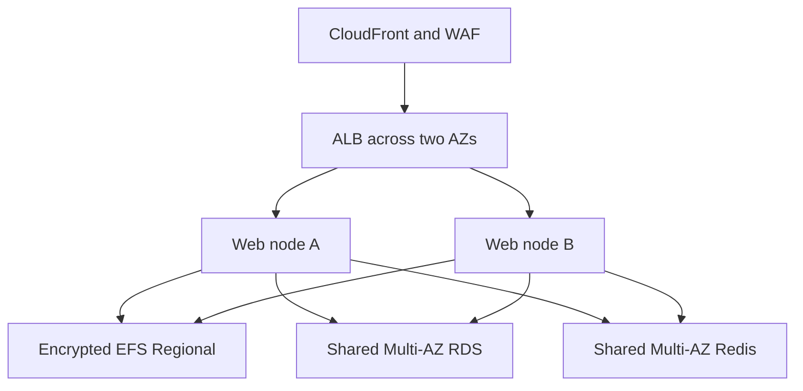

# Production web availability and capacity proposal

AWS-A09, assessed on 22 November 2026. The owner selected a balance between
availability and cost. This is a decision document: no instance was resized,
no ALB/ASG/EFS was created, and no application origin or DNS was changed.
[Sanitized evidence and cost inputs](../../tests/performance/aws-web-capacity-20261122.json)
accompany the proposal. Raw inventory, guest receipts and pricing products are
private; public resources use role aliases.

## Recommendation and decision

Prepare two always-on web nodes in different Availability Zones, an Application
Load Balancer (ALB), and encrypted EFS **Regional** for durable Drupal public and
private files. Keep the existing Multi-AZ database and cache designs, completing
the separately deferred encryption/TLS migration at production cutover.

If **platform is retired**, prefer two Linux/default-tenancy **m4.xlarge** nodes
initially: the existing regional m4.2xlarge reservation can cover both, with no
new reservation purchase. Each node has 4 vCPU and 16 GiB RAM. The existing
commitment still costs money; this is reuse of an already payable commitment,
not free compute. Confirm retirement timing with the owner before final sizing.

If **platform remains active**, it currently consumes that reservation. Do not
budget the same discount twice. Compare a short on-demand overlap against two
m6i.large nodes (2 vCPU/8 GiB each), subject to single-survivor capacity tests.
Do not buy another long commitment before measuring production demand and
clarifying the old platform's lifetime. Do not use Spot for the minimum pair.

The m4 proposal preserves the old platform's aggregate 8 vCPU/32 GiB across two
nodes, but loses half that capacity during a node/AZ failure. It is a candidate,
not certified production capacity. Regional reservations do not reserve physical
capacity; m4.xlarge is listed in three regional AZs, but successful launches and
replacement capacity must be demonstrated. Retain a tested newer x86 fallback
and price its uncovered hours. Review the aging m4 choice before renewal in 2029.

## Observed state and measurement limits

Native inventory on 22 November found three running web services in **one AZ**:
v3 t2.large, platform m4.2xlarge and www t2.micro. There are no ELBv2 load
balancers, Auto Scaling groups, EFS file systems or NAT gateways. Subnets span
three AZs; subnet existence alone does not establish a usable private network.

The active reservation is regional Linux/UNIX, default tenancy, Standard,
**No Upfront** (fixed payment zero), one m4.2xlarge at **USD 0.2419/hour**, ending
4 September 2029. Its 16 normalized units can cover two xlarge nodes (8 + 8)
across AZs. Eligibility follows the actual contract attributes and
[AWS regional size-flexibility rules](https://docs.aws.amazon.com/AWSEC2/latest/UserGuide/apply_ri.html).
Coverage must be verified in billing after cutover; it is not an instance
configuration or an assurance of spare capacity.

The [original 30-day audit](../../tests/performance/AWS-INFRASTRUCTURE-AUDIT-20261120.md)
measured v3 CPU p95 of **hourly averages** at 3.31%, observed RAM maximum at
39.8%, platform CPU maxima at 100%, and www credits exhausted in 15 hourly
samples. Those statistics neither measure concurrent user capacity nor prove a
particular replacement size will handle peak production traffic.

A fresh 48-hour window, 20 November 18:00 to 22 November 18:00 UTC, has all
48 expected samples in each of eight EC2 series. Mean hourly CPU was 2.90% v3,
3.89% platform and 5.02% www; observed hourly maxima reached 32.57%, 83.79% and
42.32%. Minimum credits were 864 v3 and 143.66 www, with no zero-credit samples.
This shorter quiet window does not invalidate the earlier exhaustion event.
Historical guest RAM is still unavailable for www/platform. Do not resize www
from CPU alone: inspect memory, PHP workers, jobs and credits before deciding.

Read-only inspection through actual default-site Drush found database-backed
sessions, database ordinary/persistent locks and the database queue factory;
the default cache uses Redis/Predis. This supports shared state in principle,
but is not a complete audit of custom queue backends or singleton jobs.

The v3 data filesystem is now **81% used**, with about 22.2 GiB available; its
120 GiB data volume and 20 GiB root are gp3 and remain unencrypted pending A06.
Public files occupy **80,152,711,168 allocated bytes** (about 74.65 GiB); the
separate private directory occupies 8,192 bytes. Temporary files are outside
public files. These allocated sizes are not an EFS billed logical-size or growth
measurement. Budget an initial **80 GiB envelope**, remeasure logical sizes,
symlinks, ownership, growth and file count before migration, and retain disk
alerts. There is no established long-term data-growth forecast yet.

## Proposed topology and state boundaries

Use an ASG with minimum/desired two nodes across two AZs. Initially allow a third
only for rolling replacement or verified scaling, with cost alerts; a third m4
xlarge exceeds the existing reservation. Ensure placement and spare capacity
support replacing a failed node. ALB health checks must test PHP and required
readiness without sending mail, claiming queues or leaking diagnostics. Tune
thresholds, grace periods and draining from measured startup times; ALB routing
alone does not prove the application recovers correctly.

Keep code, Composer dependencies and built assets in a versioned local image or
release on each node; do not mount the entire current data volume on EFS.
Share only durable public/private uploads and required generated file trees.
Keep private paths outside the web root. Store logs centrally; bound local
logs/temp/cache; keep backups separate. Require EFS encryption at rest and TLS
mounts, mount targets in both node AZs, and NFS security groups restricted to the
web security group. EFS Regional replicates across AZs; One Zone would retain the
failure domain this proposal aims to remove.
[AWS EFS file-system types](https://docs.aws.amazon.com/efs/latest/ug/features.html)
describe that distinction.

Keep sessions and locks on shared stores and verify session continuity between
nodes without relying on stickiness. Identify every cron, feeder and queue
consumer; use a single scheduler and shared leases/locks, or demonstrate safe
concurrent operation and idempotent retries. Include search indexing,
translations, exports and mail in this review. Never clone crontabs and enable
all background jobs on both nodes without those checks.

Use CloudFront-only HTTPS access to the ALB, restricted by the managed prefix
list and a secret origin header, with target ingress only from the ALB security
group. Obtain the ALB certificate in its region and preserve the separate
CloudFront viewer certificate requirements, forwarded Host/SNI, trusted-proxy
settings, canonical redirects and client-IP handling. Never commit the secret.
[AWS's ALB origin protection guidance](https://docs.aws.amazon.com/AmazonCloudFront/latest/DeveloperGuide/restrict-access-to-load-balancer.html)
is the reference. SSH restrictions remain outside the authorized work.

Budget the lower-fixed-cost network option explicitly: nodes can have public
IPv4 for outbound traffic while receiving application traffic only through
private ALB target connections and restricted security groups. This is a future
network design requiring rule review; it is not a claim that today's SSH rules
already satisfy it. If policy requires private nodes, use independent outbound
paths per AZ and include two NAT gateways or a separately costed endpoint/egress
design. A single shared NAT would introduce an avoidable AZ dependency. No NAT
or public-address change is executed by this document.

CloudFront currently has **two logical origins pointing to the same EC2**, for
dynamic and static traffic; that is not redundancy. Migrate both consistently
to the ALB and install the [static-cache MIME guard](CloudFrontStaticCache.md)
on every node, preserving marker/auth/query/cache-key behavior and private,
error, ACME and HTML exclusions. Test both paths through each node and the edge.

## Availability and recovery targets for approval

These are proposed objectives for the **new production Drupal service**, not an
AWS SLA or a demonstrated result. They do not certify the separate WordPress
www site. Keep www at its current size during assessment, add guest-memory and
PHP/job measurements before a size decision, and require an encrypted backup,
a timed restore and alert ownership for its single-node risk. Its historical
credit exhaustion warrants peak observation despite the quiet recent window.
If the business objective includes www, explicitly fund and test its own shared
files/database and redundant serving design; do not count the Drupal pair as
WordPress failover. Platform retirement must include disabling its old jobs only
after the replacement service is verified and rollback is agreed.

| Situation | Proposed objective | Acceptance evidence still required |
| --- | --- | --- |
| Normal monthly service | 99.9% time-based availability, approximately 43.2 unavailable minutes per 30 days | Minute-resolution synthetic critical journeys, alert routing and a full observation period |
| One node or one AZ fails | RTO at most 15 minutes; target no loss of acknowledged durable writes from a web-node failure | Remove a node/AZ path under controlled representative load; retain sessions, uploads and writes on the survivor |
| Region-wide loss, corruption or destructive deployment | Provisional four-hour recovery RTO and at most 24-hour backup RPO | Timed full restore, coherent database/files recovery point, DNS/origin switch and business verification |

Measure time-based availability from agreed external critical journeys: login,
search, device/project reads and a controlled safe write in the test environment.
Report request failure rates separately, including timeouts and workflow errors;
a 2xx response alone is insufficient. Distinguish expected auth/WAF denials
from service failures. Report planned downtime separately and state whether the
business SLO includes it before publishing compliance. Assign an alert owner and
escalation path; probes without a responder do not meet the objective.

The [existing disk recovery drill](V3VolumeRecovery.md) checked 52 sampled files
and 12 FPM HTTP responses. It did **not** demonstrate a four-hour full recovery,
all uploaded files, a boot of the restored OS, or an application-consistent
DB/files restore point. Daily snapshots imply up to 24 hours of file loss; RDS
PITR alone does not repair a missing matching upload. EFS AZ replication is not
a backup. Define EFS backup retention and restore testing before retiring the
old EBS file source; update the recovery plan for the new storage layout.

## Monthly comparison

Prices retrieved on 22 November from the AWS Price List Query API for Frankfurt;
USD, 730 hours/month, before tax. Use the inputs in the accompanying JSON to
recalculate. These are web-layer scenarios, **not the whole AWS bill**.

| Common two-node layer | Assumption | USD/month |
| --- | --- | ---: |
| Local gp3 roots | Two 30 GiB roots, baseline included IOPS/throughput | 5.71 |
| EFS Regional Standard | 80 GiB envelope at 0.36/GiB-month | 28.80 |
| ALB base | 0.027/hour | 19.71 |
| ALB capacity | One average LCU at 0.008/LCU-hour, an estimate | 5.84 |
| Public IPv4 | Minimum four addresses: two ALB plus two web nodes | 14.60 |
| **Common subtotal** | Before variable throughput, backups and traffic | **74.66** |

| Scenario | Existing RI commitment | New compute | Web layers | Subtotal/month |
| --- | ---: | ---: | ---: | ---: |
| Two m4.xlarge, platform retired | 176.59 | 0.00 | 74.66 | **251.25** |
| Two m4.xlarge while platform still runs | 176.59 | 350.40 | 74.66 | **601.65** |
| Two m6i.large while the RI remains payable | 176.59 | 167.90 | 74.66 | **419.15** |
| One m4.2xlarge after platform retirement, one AZ | 176.59 | 0.00 | 16.98 | **193.57** |

Rows use unrounded amounts before totals. The single-node comparator assumes
140 GiB gp3 and one IPv4; it retains file/web single points of failure and is not
the recommendation. The HA premium over this particular steady-state comparator
is approximately **57.68/month**, before variable items. That is not a forecast
of savings against the current account: www, retained staging v3, existing old
volumes, RDS, Redis, CloudFront, WAF, mail, backups and migration resources are
excluded from these subtotals and remain payable until explicitly retired.
The m6i row includes the old RI commitment even if it becomes idle; the two
m6i nodes alone cost 167.90/month and cannot consume an m4 reservation.

The m4 overlap adds 0.48/hour for the pair; even a one-week overlap adds about
80.64 in compute alone. AWS may allocate the flexible RI to smaller eligible m4
nodes first, leaving equivalent platform units on demand; the combined account
cost, not which node displays the discount, is what matters.

For private nodes with **two zonal NAT gateways**, add approximately
**75.92/month fixed** (2 x 0.052 x 730), plus 0.052/GB processing. Four minimum
IPv4 addresses still apply: two ALB plus two NAT, replacing the two node IPv4s.
Private endpoints can add per-AZ hourly and data charges and do not replace all
Internet egress. Any IPv6/VPC-origin alternative needs its own compatibility and
routing review; none is silently assumed free here.

EFS Elastic throughput adds **0.04/GB read and 0.07/GB write**; an illustrative
100 GB read + 10 GB write is 4.70/month, not a measured workload. Metadata/minimum
metering, generated image styles, cache misses and migration reads may matter.
Do not rely on a small EFS filesystem's burst credits for guaranteed sustained
throughput. Benchmark before choosing Bursting versus Elastic and retain the
variable throughput line in the budget. EFS lifecycle savings, ALB LCU demand,
backup storage/restore, cross-AZ and Internet data charges remain unmeasured.
ALB scaling can allocate more than the minimum IPv4 addresses budgeted above.

Pricing references: [EC2](https://aws.amazon.com/ec2/pricing/on-demand/),
[ALB and LCU dimensions](https://aws.amazon.com/elasticloadbalancing/pricing/),
[EFS storage and throughput](https://aws.amazon.com/efs/pricing/), and
[VPC NAT/IPv4/endpoint charges](https://aws.amazon.com/vpc/pricing/).
The regional API rate records are authoritative for the numbers above; examples
on pricing pages can use a different region.

## Implementation, validation and rollback gates

1. Decide platform retirement/overlap, www scope, the proposed availability and
   recovery objectives, network option and operating budget. Keep this proposal
   open for review until those choices are recorded. Do not enlarge v3 now from
   idle CPU data or promise savings while the reservation remains occupied.
2. Complete source mapping: all durable paths, file references/symlinks, secrets,
   queues/cron, PHP worker RSS/max_children, session/lock behavior and actual
   traffic/concurrency. www stays a separately measured service; a healthy new
   v3 pair does not certify WordPress or the old platform.
3. Build reproducible x86 images with locked compatible runtime/dependencies,
   scoped access, SSM management, bounded local storage and required extensions.
   Coordinate A06 encryption/TLS/RBAC and A07 maintenance in the already deferred
   production window; do not revive those operations merely for this proposal.
4. Provision the chosen two-AZ design as reviewed infrastructure code in an
   isolated preproduction environment. Copy files with metadata checks, then
   perform a final synchronized pass with writes quiesced at cutover. Use a
   coherent database/files restore point and verified encrypted backups.
5. Run existing E2E, representative k6 and Lighthouse profiles locally against
   the changed checkout and isolated data. On production-sized isolated nodes,
   establish expected peak concurrency from traffic and a justified safety
   margin; measure warm/cold cache, PHP queues/RSS, p95/p99, DB connections and
   EFS latency. Repeat with one node unavailable. Keep existing test budgets;
   no production load test, real mail or paid translation calls.
6. Verify cross-node login/session continuity, simultaneous upload/read and
   private-file denial, lock contention and queue retries without duplication,
   image generation, search, multilingual redirects and controlled mail capture.
   Exercise ALB replacement/draining, dependency failure and a timed full restore.
   Monitor ALB unhealthy hosts/5xx/latency, ASG capacity, PHP saturation,
   filesystem use/EFS throughput and DB/cache pressure through both AZs.
7. Cut over both CloudFront origins in an agreed window after tests pass. Preserve
   TLS/origin authentication, WAF behavior and static-cache exclusions; smoke
   test as the actual runtime and through the edge. Keep rollback references to
   the previous origin config, release/image and matching recoverable data.
8. Drain the old source and disable duplicate background workers. Retain it
   privately for a bounded, costed rollback period. After new writes begin, an
   origin-only rollback to stale EBS/DB is unsafe: quiesce writes and reconcile
   files/database or deliberately recover to the agreed recovery point first.
   Retire old resources only after data checks, billing coverage and an agreed
   observation period. Do not terminate the old platform in this assessment.

## Validation of this deliverable

Only documentation and sanitized aggregate evidence are changed. Validate JSON,
independent arithmetic, relative references, diff scope and absence of native
resource IDs/secrets before publication. Browser/load/audit runs do not establish
an unimplemented two-node architecture and are not required for this document.
Native read-only inventory, contract, metric and guest observations support the
facts above; capacity, failover, SLO/RTO/RPO compliance and savings remain future
acceptance gates. No runtime-version compatibility is certified by this proposal.
